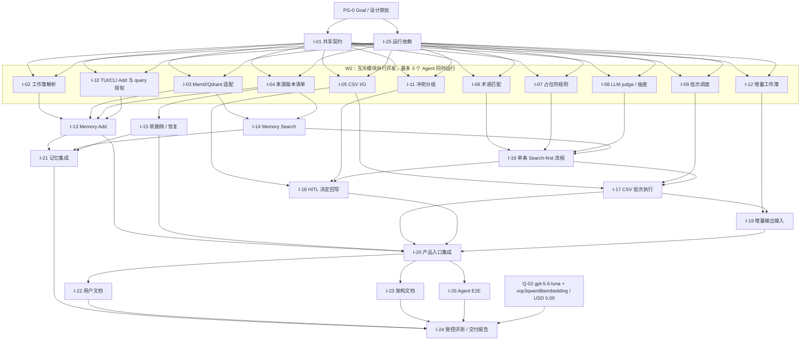

# Issue 依赖图：TinyCode CSV 词条英文翻译与术语消歧

## 图谱元数据

- Goal：[[goal.md]]（`tinycode-csv-term-translation` / `draft-7`，未批准、暂缓）
- 仓库：`deosiree/tinycode`（fork；不得向 `helsome/tinycode` 上游写入）
- 最后核对 GitHub：2026-11-25；`deosiree/tinycode` 的 `hasIssuesEnabled=true`；延期跟踪 Issue [#2](https://github.com/deosiree/tinycode/issues/2) 为 Open，并链接至[规划分支](https://github.com/deosiree/tinycode/tree/feature/csv-term-translation)，当前规划快照为 `9d969e0`；26 个候选功能 Issue 尚未发布；PR #1 已合并到 `main`。用户已授权在该 fork 使用 Issues；功能 Issue 草稿未获逐项批准前不创建。
- 依赖事实源：下方 Issue 表；Mermaid 只作展示。
- 执行状态：用户已决定暂缓 CSV 业务 Goal，转以通用 Agent Harness 学习为主线；GitHub #2 仅跟踪未来恢复入口，当前 26 个候选功能 Issue 均不执行。以后用户明确开始真实业务场景二开时，重新核对状态并审阅 Goal、依赖图和具体 Issue 草稿后再决定发布。上游 `helsome/tinycode` 不在授权范围内。
- 执行门禁：解锁 Issue 仍需读取实时 GitHub 状态；先保存该 Issue 的 `develop.md` 并由用户确认关键差异，再建立隔离 worktree/分支。
- 目标分支策略草稿：Issue PR 依依赖顺序合入 `feature/csv-term-translation`；最终集成 PR 指向 `main`。创建每个 PR 前重新核验 fork 在线规则与目标分支。
- 执行并发：无依赖不自动代表可并行；仅在接口冻结、文件所有权互斥、测试数据隔离且每项使用独立 worktree 时启用。最多 3 个 Agent 同时执行。
- 计划/任务对齐：`tasks.md` 基线已包含于 `c4a788e`；本轮不修改它。图谱记录的是待审职责重排，不能把已提交文件或既有 Plan 视为用户批准。

## 节点与依赖

| Local ID | GitHub Issue | 标题/单一职责 | Goal IDs | Blocked by | Wave | 并行组 | 文件所有权（完成任务重排后） | 状态 |
| --- | --- | --- | --- | --- | --- | --- | --- | --- |
| I-01 | draft | 冻结共享领域类型与外发授权契约 | G-01..G-09 | PG-0 | 1 | W1-shared-contract | `src/term-translation/types.ts`, `src/term-translation/consent.ts` | `draft` |
| I-02 | draft | 解析参考工作簿并保留来源定位 | G-01 | I-01,I-25 | 2 | W2-independent-modules | `src/term-translation/glossary.ts`, `tests/term-translation/glossary-parse.test.ts` | `draft` |
| I-03 | draft | 封装 Mem0 OSS 与 loopback Qdrant add/search adapter | G-01,G-02,G-08 | I-01,I-25 | 2 | W2-independent-modules | `src/term-translation/mem0-adapter.ts`, `tests/term-translation/mem0-adapter.test.ts` | `draft` |
| I-04 | draft | 实现来源版本清单与原子 active 指针 | G-02 | I-01,I-25 | 2 | W2-independent-modules | `src/term-translation/source-manifest.ts`, `tests/term-translation/source-manifest.test.ts` | `draft` |
| I-05 | draft | 实现 CSV 读取、保真写入与固定输出路径 | G-04 | I-01,I-25 | 2 | W2-independent-modules | `src/term-translation/csv.ts`, `tests/term-translation/csv.test.ts` | `draft` |
| I-06 | draft | 实现中文切分与参考术语匹配 | G-03,G-06 | I-01,I-25 | 2 | W2-independent-modules | `src/term-translation/translation.ts`, `tests/term-translation/translation.test.ts` | `draft` |
| I-07 | draft | 实现确定性占位符与逐行规则检查 | G-06 | I-01,I-25 | 2 | W2-independent-modules | `src/term-translation/quality.ts`, `tests/term-translation/placeholder-quality.test.ts` | `draft` |
| I-08 | draft | 实现 LLM judge 与伪代码术语抽查门禁 | G-03,G-06 | I-01,I-25 | 2 | W2-independent-modules | `src/term-translation/llm-quality.ts`, `tests/term-translation/llm-quality.test.ts` | `draft` |
| I-09 | draft | 实现可注入处理器的批次/并发调度器 | G-05 | I-01,I-25 | 2 | W2-independent-modules | `src/term-translation/batching.ts`, `tests/term-translation/batching-scheduler.test.ts` | `draft` |
| I-10 | draft | 实现 TUI/CLI 的 Add 与 query Embedding 授权适配 | G-01,G-03,G-08 | I-01,I-25 | 2 | W2-independent-modules | `src/tui/external-data-consent.ts`, `src/cli/external-data-consent.ts`, `src/tui/app.ts`, `src/cli/index.ts`, `tests/term-translation/add-consent.test.ts`, `tests/term-translation/query-consent.test.ts` | `draft` |
| I-11 | draft | 发现翻译冲突并构造稳定审核组 | G-06 | I-01,I-25 | 2 | W2-independent-modules | `src/term-translation/conflicts.ts`, `tests/term-translation/conflicts.test.ts` | `draft` |
| I-12 | draft | 生成独立的高频未知词增量工作簿 | G-07 | I-01,I-25 | 2 | W2-independent-modules | `src/term-translation/glossary-delta.ts`, `tests/term-translation/glossary-delta.test.ts` | `draft` |
| I-13 | draft | Add 参考资料并发布完整来源版本 | G-01,G-08 | I-02,I-03,I-04,I-10 | 3 | W3-memory-operations | `src/term-translation/memory-add.ts`, `src/tools/add-reference-material.ts`, `tests/term-translation/memory-add.test.ts` | `draft` |
| I-14 | draft | Search 当前项目的 active 参考记忆 | G-02,G-03,G-08 | I-03,I-04 | 3 | W3-memory-operations | `src/term-translation/memory-search.ts`, `tests/term-translation/memory-search.test.ts` | `draft` |
| I-15 | draft | 软删除来源并恢复指定历史版本 | G-02 | I-04 | 3 | W3-memory-operations | `src/term-translation/memory-lifecycle.ts`, `src/tools/manage-reference-memory.ts`, `tests/term-translation/memory-lifecycle.test.ts` | `draft` |
| I-16 | draft | 编排单条 search-first 翻译与 judge 流程 | G-03,G-06,G-08 | I-06,I-07,I-08,I-14 | 4 | W4 串行链 | `src/term-translation/workflow.ts`, `tests/term-translation/workflow.test.ts` | `draft` |
| I-17 | draft | 执行 CSV 批次、落盘并从固定输出恢复 | G-04,G-05 | I-05,I-09,I-16 | 5 | W5-runner-review | `src/term-translation/translation-runner.ts`, `tests/term-translation/translation-runner.test.ts` | `draft` |
| I-18 | draft | 应用 HITL 决定并安全回写审核记录 | G-06 | I-05,I-11,I-16 | 5 | W5-runner-review | `src/term-translation/review-decisions.ts`, `tests/term-translation/review-decisions.test.ts` | `draft` |
| I-19 | draft | 将高频未知词统计接入翻译输出 | G-07 | I-12,I-17 | 5+（I-17 完成后解锁） | W5-runner-review | `src/term-translation/delta-workflow.ts`, `tests/term-translation/delta-workflow.test.ts` | `draft` |
| I-20 | draft | 暴露并注册工具和用户工作流入口 | G-01..G-09 | I-13,I-15,I-17,I-18,I-19 | 6 | W6 串行集成 | `src/tools/csv-term-translation.ts`, `src/tools/index.ts`, `src/bootstrap.ts`, `.tinycode/skills/csv-term-translation/SKILL.md` | `draft` |
| I-21 | draft | 验证本机参考记忆 Add/Search/生命周期集成 | G-01,G-02,G-08 | I-13,I-14,I-15 | 6 | W6-memory-integration | `tests/term-translation/memory.integration.test.ts` | `draft` |
| I-22 | draft | 编写可复现的用户运行指南 | G-01..G-09 | I-20 | 7 | W7-cross-validation | `specs/001-csv-term-translation/quickstart.md`, `README.md` | `draft` |
| I-23 | draft | 更新与实现一致的架构说明 | G-01..G-09 | I-20 | 7 | W7-cross-validation | `ARCHITECTURE.md` | `draft` |
| I-24 | draft | 执行获批模型评测并形成最终交付报告 | G-03,G-06,G-09 | I-21,I-22,I-23,I-26,Q-02 | 9 | W9 终验 | `specs/001-csv-term-translation/delivery-report.md` | `draft` |
| I-25 | draft | 锁定功能运行依赖与可复现安装基线 | G-01,G-08 | PG-0 | 1 | W1-runtime-dependencies | `package.json`, `package-lock.json` | `draft` |
| I-26 | draft | 验收 TinyCode Agent 端到端翻译与审核工作流 | G-01,G-03,G-04,G-05,G-06,G-07,G-08,G-09 | I-20 | 8 | W8-agent-e2e | `tests/harness.e2e.test.ts`, `tests/fixtures/term-translation/**` | `draft` |

### 非 Issue 规划门禁

- `PG-0`：用户批准 `goal.md`、`issue-graph.md` 和设计基线；不代表授权启用 GitHub Issues。
- `PG-2`：用户逐项批准待发布的 Issue 草稿后才创建到 `deosiree/tinycode`；Issues 已开启，任何变更都不得指向上游。
- `Q-02`：用户已确认 I-24 使用 OpenAI `gpt-5.6-luna` 与讯飞星火 Embedding `xop3qwen8bembedding`（OpenAI-compatible）及合计 `USD 5.00` 上限，并补充该 Embedding 接口限时免费至 `2026-12-31 02:00`（时区未注明）。一次合成 smoke test 返回 HTTP 200、768 维、13 input tokens，按用户提供的优惠信息计为优惠期内免费；公开资料未能独立核实该调用名对应的优惠细则，响应本身也未返回货币金额。I-24 完整评测仍未运行；产品 Embedding 基线是否从 OpenAI 切换另行审阅。
- 平台验证要求（不作为额外项目门禁）：I-21 留存 Windows named volume 重启与配对备份/恢复证据；I-22 只记录已验证的平台命令，macOS/Linux 未实测项标 `not-run`。

### 依赖类型与并行规则

- `blocked_by` 是实现前置；`PG-*` 是项目级门禁，不是 GitHub Issue。
- `related` 不阻塞实现，不画成依赖边。
- 同一波仅表示依赖允许并行；还必须有冻结接口、互斥路径、隔离测试数据和独立 worktree。并行组是候选池，执行仍受前置依赖和最多 3 个 Agent 的限制。
- 每轮最多 3 个 Agent；主控审查每个工作树的完整 diff、运行节点验证并按依赖顺序集成。
- 下游 Issue 可在前置 Issue 已集成到本地功能分支并合并后启动；不能只凭前置 PR 创建或测试通过就解锁。
- 每个 Issue 的 PR 都以 fork 功能集成分支为 base；最终集成 PR 的 base 在实时核对仓库规则后确认。

## 依赖关系图

## Goal 覆盖

| Goal 验收 ID | Issue / 项目级验收 | 状态 |
| --- | --- | --- |
| G-01 | I-02,I-03,I-13,I-20,I-21,I-26 | `mapped` |
| G-02 | I-03,I-04,I-14,I-15,I-21 | `mapped` |
| G-03 | I-08,I-10,I-14,I-16,I-24,I-26 | `mapped` |
| G-04 | I-05,I-17,I-26 | `mapped` |
| G-05 | I-09,I-17,I-26 | `mapped` |
| G-06 | I-06,I-07,I-08,I-11,I-16,I-18,I-24,I-26 | `mapped` |
| G-07 | I-12,I-19,I-26 | `mapped` |
| G-08 | I-03,I-10,I-13,I-14,I-16,I-21,I-26 | `mapped` |
| G-09 | I-20,I-21,I-22,I-23,I-24,I-26 | `mapped; evidence pending` |

## 职责与范围复核

- I-01 与 I-25 拆开：共享领域类型/授权契约和依赖安装是不同交付，路径互斥，可在 PG-0 后并行；后续模块等两者合并。
- I-04 只提供来源清单的原子读写和状态原语；软删除/恢复策略和用户操作由 I-15 负责，避免两边同时定义生命周期。
- I-03 的 API adapter 可用 mock endpoint 独立实现；Windows named volume 和来源清单的双存储布局已由 Q-01 裁定，具体运行及备份验证留给 I-21/I-22。
- I-21 专门验证 Add/Search/来源生命周期与真实本机 Qdrant 的跨服务持久化；Windows 还验证 named volume 在容器重建后保留数据，以及 volume 与来源清单的配对备份/恢复。I-26 用 deterministic mock 验证已注册 Agent 全流程。两类集成测试写不同文件，可在 I-20 合并后并行验收。
- I-22 在 Quickstart/README 中给出经验证的 Windows named volume 操作与配对备份说明；macOS/Linux 的 `dataHome()` 挂载命令仅在实测后写为可用步骤，其他情况明确标 `not-run`。
- I-10 保留 Add/query 授权在同一 Issue，因为两者共享 TUI/CLI 外发授权适配边界；Add 与 query 的授权范围仍由独立接口和测试隔离。
- I-20 保留工具注册与 skill 入口，因为它们共同交付可被用户调用的产品入口；I-21/I-26 不修改其运行时代码。
- I-22/I-23/I-24 分别只负责用户运行指南、架构说明、受控评测/交付报告；T055 通用仓库门禁属于 Goal 终验，不单独创建 GitHub Issue。
- 未为各节点估算人日；当前尺寸判断按一个可独立审查的模块或纵向验收能力，而不是按文件数量。

## 待同步的任务重排

`../tasks.md` 的基线在 `c4a788e` 中；本轮仅修改本地 Issue 草稿，不覆盖该文件。创建 Issue 前需要用户审阅并单独批准下列重排，然后同步 Spec/Plan/Tasks 和所有 develop 计划：

- 将 T014/T015/T016 从一个 `memory.ts` 拆为 `memory-add.ts`、`memory-search.ts`、`memory-lifecycle.ts`，使 Add、Search、软删除/恢复各自具有独占服务路径和独立测试文件。
- 将 T002 依赖/lockfile 从 T003/T004 共享契约中拆出；I-25 仅维护 `package.json`/`package-lock.json`，I-01 仅维护 `types.ts`/`consent.ts`。
- 将 T006/T048 共用的 `glossary.test.ts` 拆为 parser 与 delta 专属测试文件；I-12 的生成逻辑落到新增 `glossary-delta.ts`，不与 parser 共写 `glossary.ts`。
- 将 T030 占位符检查与 T031/T032 的 LLM judge/伪代码抽查拆为独立模块和测试文件，避免并行 Agent 修改同一 `quality.ts`。
- 将 T045 的审核决定应用从 `workflow.ts` 拆为 `review-decisions.ts`；I-16 独占 `workflow.ts`，I-18 独占审核服务。
- 将批次调度器与 CSV 任务执行器分开：I-09 只提供通用 scheduler，I-17 使用 `translation-runner.ts` 编排文件读取、检查点和逐行 workflow。
- T019/T035/T038/T046 的注册和工具入口归 I-20；Add 与生命周期 Issue 可各自实现其工具 adapter，但不得修改共享 `bootstrap.ts`。
- 将 T009 的 Add/Search/生命周期持久化场景整体交给 I-21 集成测试；纳入 Windows named volume 容器重建和 volume/来源清单配对备份恢复验证。T053 用户文档同步记录该存储与备份契约。解析器的 sheet/row 映射仍由 T006/T011 在 I-02 覆盖。上述任务正文待用户批准整体任务重排后再更新 `tasks.md`。
- 将 T025/T034 的 scheduler 行为分配给 I-09，批次落盘、失败继续和恢复分配给 I-17；拆分后的测试与实现文件分别归单一 Issue。
- 将 T042 的冲突分组场景分配给 I-11，过期/同实体/异实体决定场景分配给 I-18。
- 将 T026/T052 的 Agent 全流程 fixture 和 harness 验收归 I-26；T055 通用 test/typecheck/lint/build/JSDoc/平台门禁作为项目级终验，不分配给 Issue。
- 移除 T001/T005/T020/T040/T047/T051/T058 中作为功能任务的 Git 操作；worktree、批次提交、review/integration 规则留在 Goal/Issue develop 执行流程。

## 原任务编号映射草案

以下是原任务到候选 Issue 的追溯关系。`/` 后缀表示计划拆分的逻辑片段，不是已写入 `tasks.md` 的正式编号；批准后统一重编号，避免一个原任务被两个 Issue 同时领取。

| Issue | 原 tasks 编号 | 重排说明 |
| --- | --- | --- |
| I-01 | T003,T004 | 仅共享类型与授权契约；依赖基线移至 I-25 |
| I-02 | T006,T011 | 解析测试/实现；解析测试改为独立文件 |
| I-03 | T007,T012 | adapter 使用 mock 验证；真实 Qdrant 持久化由 I-21 覆盖 |
| I-04 | T008,T013 | 来源 manifest 原子清单和状态原语；用户可见 lifecycle 移出 |
| I-05 | T021,T028 | CSV I/O 测试和实现 |
| I-06 | T022,T029 | 术语切分/匹配测试和实现 |
| I-07 | T023,T030 | 确定性占位符检查；从共用 quality 文件隔离测试 |
| I-08 | T031,T032 | LLM judge 与伪代码术语抽查，移至 `llm-quality.ts` |
| I-09 | T025/Scheduler,T034/Scheduler | 只负责通用批次及并发调度，不负责文件落盘 |
| I-10 | T010,T027,T036,T037 | Add/query 外发授权适配；作用范围由独立测试确认 |
| I-11 | T041,T042/Conflict,T043,T044 | 冲突检测和稳定分组；审核决定测试移至 I-18 |
| I-12 | T048,T049 | 增量工作簿生成；测试使用独立文件 |
| I-13 | T014,T017 | Add service 与 tool adapter；授权范围由 I-10 提供 |
| I-14 | T015 | Search service；集成场景由 I-21 覆盖 |
| I-15 | T016,T018 | lifecycle service、恢复无 Embedding 和管理 tool |
| I-16 | T024,T033 | 每行 Search-first workflow 与 trace |
| I-17 | T025/Runner,T034/Runner | CSV 批次执行器与 checkpoint；不重写 I-09 scheduler |
| I-18 | T042/Review,T045 | 审核决定服务；测试移至独立 review 文件 |
| I-19 | T050 | 将 I-12 生成器接入批次结果，审核状态与 CSV 状态分离 |
| I-20 | T019,T035,T038,T039,T046 | 工具/注册/skill 与操作 adapter 集成 |
| I-21 | T009 | 本机 Qdrant 持久化和 Add/Search/lifecycle 集成测试 |
| I-22 | T053 | Quickstart 与 README |
| I-23 | T054 | 架构说明 |
| I-24 | T056,T057 | 获批真实评测与交付报告 |
| I-25 | T002 | 依赖版本锁定与干净安装，不修改领域契约 |
| I-26 | T026,T052 | 脱敏 fixture 与 Agent 全流程 harness E2E |
| 项目级终验/执行规范，不建 Issue | T001,T005,T020,T040,T047,T051,T055,T058 | worktree、分批提交、全仓门禁、review/integration 等流程记录；不代表独立产品功能 |

## 图谱检查结果

- 唯一节点 ID：`pass`（I-01..I-26）。
- 缺失节点引用：`none`。
- 环检测：`pass`（所有边从前置层指向后续层；PG/Q 标记为门禁）。
- 未映射 Goal ID：`none`。
- 路径/接口冲突：`draft pass after task reallocation`; 未批准前禁止按当前 tasks 并行。
- 可安全并行节点及依据：I-01/I-25 在 PG-0 后因路径互斥可并行；I-02..I-12 在两项基础 Issue 合并后是并行候选池。I-13/I-14/I-15 各自独占服务路径；I-17/I-18 可并行；I-19 在 I-17 完成后可与 I-18 并行。I-21 的服务集成测试可在其三个依赖完成后，与 I-16..I-20 并行；I-26 在 I-20 合并后可与 I-21/I-22/I-23 并行（各自使用隔离 worktree）。
- 当前已解锁节点：`none`（PG-0 尚待用户批准；Q-02 已解决）。

## 本地图与 GitHub 同步记录

| 时间 | 节点 | 本地依赖 | GitHub 依赖读回 | 结果/原因 |
| --- | --- | --- | --- | --- |
| 2026-11-25 | I-01..I-26 | 草稿 DAG | 不适用 | `draft`; fork Issues 关闭，尚无 Issue 创建授权 |
| 2026-11-25 | GitHub 状态刷新 | 不适用 | `deosiree/tinycode`：Issues enabled；Issue 列表为空；PR #1 merged → `main` | Q-03 用户授权已记录；未创建 Issue |
